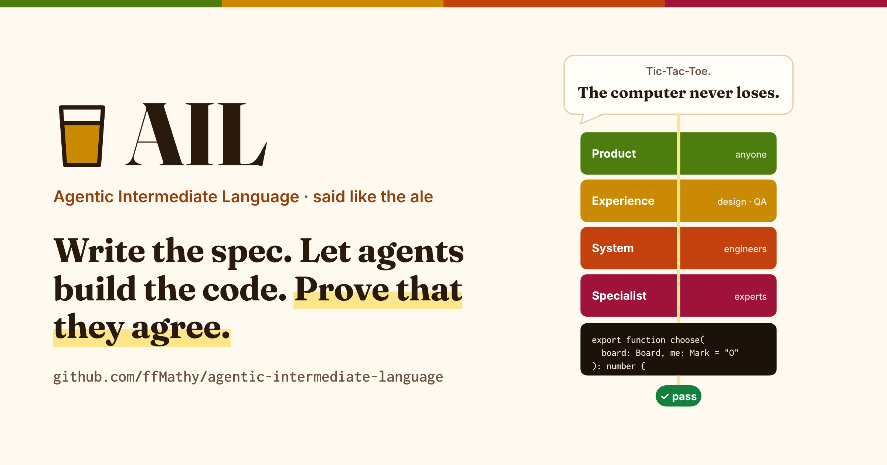
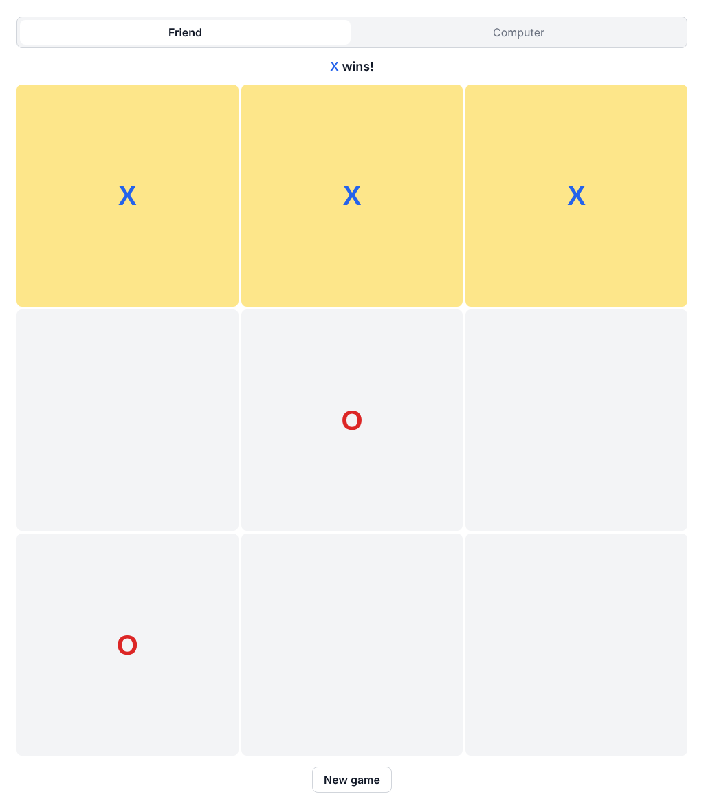
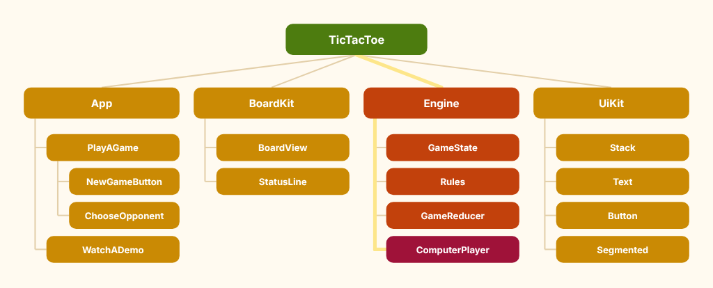
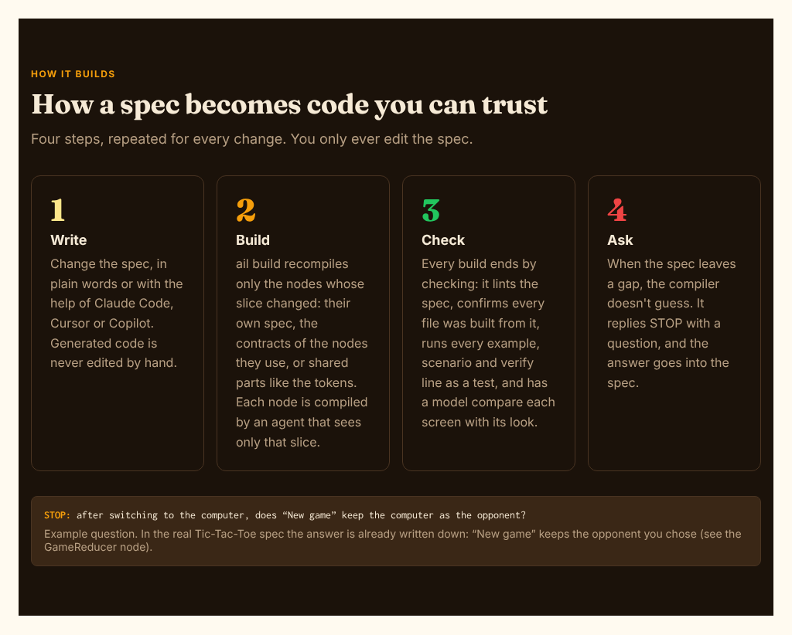
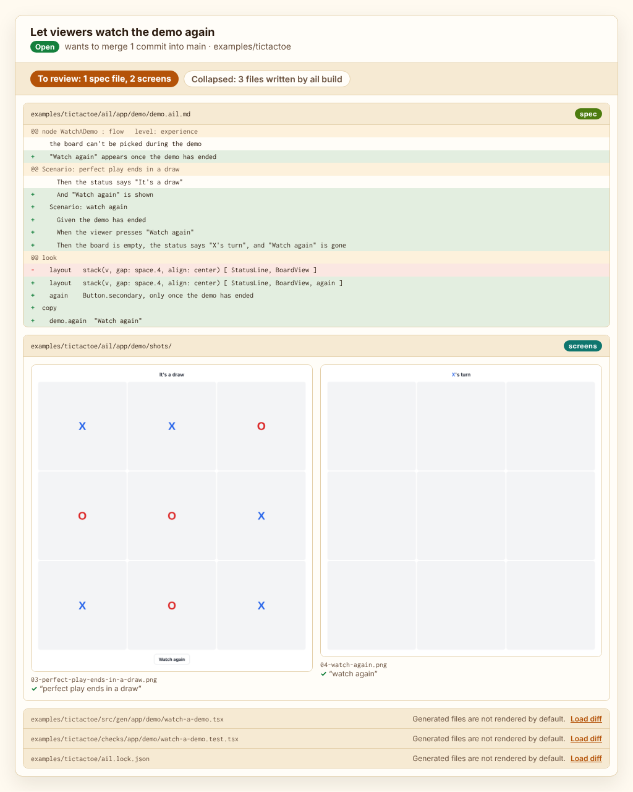
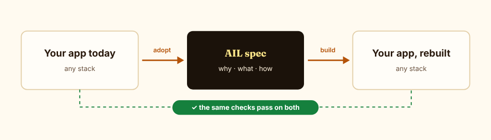

# AIL — Agentic Intermediate Language

[](https://ffmathy.github.io/agentic-intermediate-language/)



🌐 **[Website](https://ffmathy.github.io/agentic-intermediate-language/)**, with a playable demo. The site is itself written in AIL ([`site/`](site)).

## A spec, and the screen it proves

<table>
<tr>
<td width="55%">

[`examples/tictactoe/ail/app/play/play.ail.md`](examples/tictactoe/ail/app/play/play.ail.md)

```ail
node PlayAGame : flow   level: experience
  why   Make the game understandable without instructions.   <- App
  what
    …
    Scenario: winning
      Given X has the top-left and top-middle squares,
            O has the center and bottom-left squares,
            and it is X's turn
      When X picks the top-right square
      Then the status says "X wins!"
      And the top row is highlighted
      And no more squares can be picked
```

</td>
<td>

[`shots/04-winning.png`](examples/tictactoe/ail/app/play/shots/04-winning.png)



</td>
</tr>
</table>

Each scenario becomes a test, and the screen the test ends on is committed beside the spec. A model checks it against the node's `look`.

## A spec is a tree of small tasks



Every node has a folder of its own, with its screens in `shots/`. Folders mirror the tree:

```
ail/app/play/
├── play.ail.md                    PlayAGame
├── shots/                         its screens: 01-x-always-starts.png …, e2e/
├── new-game-button/
│   ├── new-game-button.ail.md     NewGameButton
│   └── shots/
└── choose-opponent/
    ├── choose-opponent.ail.md     ChooseOpponent
    └── shots/
```

## How it builds



## What you review



The spec and the screens. Generated code is committed but collapsed: mark it in `.gitattributes`.

```gitattributes
src/gen/** linguist-generated=true
ail.lock.json linguist-generated=true
```

Every pull request's description carries the build's checks: each test with ✅ or ❌, and the screen it ended on.

## Install

| Where | Install |
|---|---|
| **Claude Code** | `/plugin marketplace add ffMathy/agentic-intermediate-language`<br>`/plugin install ail@agentic-intermediate-language` |
| **Cursor** 2.5+ | `git clone https://github.com/ffMathy/agentic-intermediate-language ~/.cursor/plugins/local/ail`, then **Developer: Reload Window** |
| **GitHub Copilot CLI** | `copilot plugin marketplace add ffMathy/agentic-intermediate-language`<br>`copilot plugin install ail@agentic-intermediate-language` |
| **VS Code agent plugins** | `"chat.plugins.marketplaces": ["ffMathy/agentic-intermediate-language"]`, then install `ail` from Agent Customizations |
| **Terminal** ([Bun](https://bun.sh) 1.2+) | `bun add -g github:ffMathy/agentic-intermediate-language` |

No API key needed: builds use the login of Claude Code, Cursor or Copilot (or `ANTHROPIC_API_KEY` when set). Guides: [Claude Code](docs/claude-code.md) · [Cursor](docs/cursor.md) · [Copilot](docs/copilot.md).

Then ask for features in plain words. The agent changes the spec, never the code.

| In an agent | In a terminal | |
|---|---|---|
| `/ail:build` | `ail build` | compile what changed, then check everything |
| `/ail:adopt` | `ail adopt` | bring an existing app under AIL |
| "show me the tree" | `ail show` | the tree, a node, or what changed (`ail show changes`) |

## Adopt an existing app



| | from |
|---|---|
| **why** | tickets (Asana, Jira, Linear) and the people who own the app |
| **what** | driving the running app: every screen and error path |
| **how** | its code: data shapes, rules, real values as examples |
| **proof** | an end-to-end check per flow, run against the old app, with a screenshot per scenario |

Then change the `target` and run `ail build`. The same checks prove the new app behaves like the old one. Example: [`examples/tictactoe/checks/e2e/`](examples/tictactoe/checks/e2e).

## In CI

```yaml
- uses: ffMathy/agentic-intermediate-language@main
  with:
    project: path/to/your/project
```

Needs `contents: write`, `pull-requests: write` and `fetch-depth: 0`. On pull requests it comments a review of the spec changes with screenshots, and writes every check into the description.

## One language, for every target

| AIL | not |
|---|---|
| `list of Cell` | `Cell[]` |
| `later boolean` | `Task<bool>` |
| `nothing` | `null` |
| `state copied: boolean, starting at false` | `useState(false)` |

The target is named once, in the `target` block. Definition: [docs/language.md](docs/language.md) · design: [docs/proposal.md](docs/proposal.md).

## Editor

[`editors/vscode`](editors/vscode): highlighting, Go to Definition and Find All References for AIL in VS Code, Cursor and github.dev. Get `ail.vsix` from the latest `vscode-v…` [release](https://github.com/ffMathy/agentic-intermediate-language/releases).

## Written in Agentic Intermediate Language

[](https://ffmathy.github.io/agentic-intermediate-language/)

[Shapeshifter](https://github.com/ffMathy/Shapeshifter) · [Valafind](https://github.com/ffMathy/valafind) · [this website](site). Add the badge to yours:

```markdown
[](https://ffmathy.github.io/agentic-intermediate-language/)
```

## Try the demo

```bash
cd examples/tictactoe && bun install && ail build && bun run dev
```

## Repository

```
src/                    the ail CLI and MCP server (Bun, TypeScript)
prompts/                instructions given to the compiling model
skills/ commands/ hooks/   the agent plugins (Claude Code, Cursor, Copilot)
examples/tictactoe/     the demo: spec, generated code, checks, lock file
editors/vscode/         the VS Code extension
site/                   the website, written in AIL
tests/                  toolchain tests
```

```bash
bun install && bun link && bun test && bun run typecheck
```

Inspired by [Recursive Language Models](https://arxiv.org/abs/2512.24601) (Zhang, Kraska and Khattab, MIT CSAIL): each node is compiled by a fresh call that sees only its own slice of the spec.
