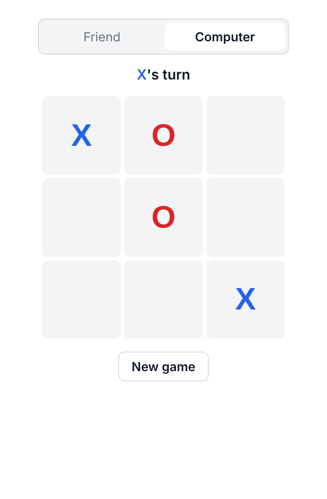

# agentic-intermediate-language

**AIL** is a recursive *why / what / how* specification language for software
built by agents. People review the IL. An agent compiles it into code, and
`ail verify` proves that the code does what the IL says, whichever model or
vendor wrote it.

```ail
node TicTacToe : system   level: product
  why   A quick, familiar game people can finish in under a minute.
  what
    4. The computer never loses.          refined-by: ComputerPlayer
    ...
```

The top of the tree reads like a product brief. Each level down is more
precise, ending at specialist nodes with algorithms, invariants and proofs.
See [`docs/proposal.md`](docs/proposal.md) for the design, and
[`examples/tictactoe`](examples/tictactoe) for a complete kata, compiled and
verified.



## Install

The toolchain needs [Bun](https://bun.sh) 1.2 or later.

```bash
bun install
```

```bash
bun src/cli.ts help
```

As a Claude Code plugin (skills, MCP tools, hooks and slash commands):

```
/plugin marketplace add ffMathy/agentic-intermediate-language
/plugin install ail@agentic-intermediate-language
```

## Try the kata

```bash
cd examples/tictactoe && bun install
```

```bash
bun ../../src/cli.ts lint
```

```bash
bun ../../src/cli.ts verify
```

```bash
bun ../../src/cli.ts lens stakeholder
```

```bash
bun run dev
```

## Commands

| command | what it does |
|---|---|
| `ail lint` | structure, why-traceability, refinement links, per-level vocabulary, catalog references, cycles |
| `ail plan [--check]` | which nodes are fresh, stale, missing or hand-edited |
| `ail context <Node>` | the encapsulated slice of the spec one compile step sees |
| `ail compile [Node…]` | compile stale nodes: model → verify → retry → lock |
| `ail submit <Node> <file>` | hand in code written by an agent: verified and locked, or rolled back |
| `ail verify [Node…]` | examples, derived checks, import boundaries, drift, typecheck |
| `ail derive <Node>` | turn scenarios and verify items into pinned tests |
| `ail diverge [Node…]` | sample N× per model; report where behaviour disagrees |
| `ail lens <audience>` | stakeholder, design, engineer or specialist (`--tag`) view |
| `ail review --base <ref>` | semantic IL diff, grouped by who should review it |
| `ail lift <file>` | draft IL from existing code |
| `ail mcp` | MCP server exposing all of the above |

Models are given as `--model <spec>`. Repeat the flag for `diverge`.

| spec | provider |
|---|---|
| `anthropic:claude-opus-5-5` | Anthropic API (the default; uses `ANTHROPIC_API_KEY`) |
| `openai:<model>` | any OpenAI-compatible endpoint (`OPENAI_BASE_URL`, `OPENAI_API_KEY`) |
| `command:<cli>` | any CLI that reads a prompt on stdin, e.g. `command:claude -p` |
| `mock:<file.json>` | canned replies for tests |

## Repository layout

```
src/                 the ail toolchain (Bun, TypeScript)
profiles/            target profiles: settings, catalog, glue templates, golden examples
skills/              agent skills: author, compile-leaf, derive-checks, review, lift
commands/            slash commands for the plugin
hooks/               plugin hooks (block generated-file edits, lint IL edits)
examples/tictactoe/  the kata: IL, generated code, derived checks, lock file
tests/               toolchain tests (bun test)
docs/proposal.md     the design
action.yml           GitHub Action: lint, plan --check, verify, review summary
```

## Develop

```bash
bun test
```

```bash
bun run typecheck
```
